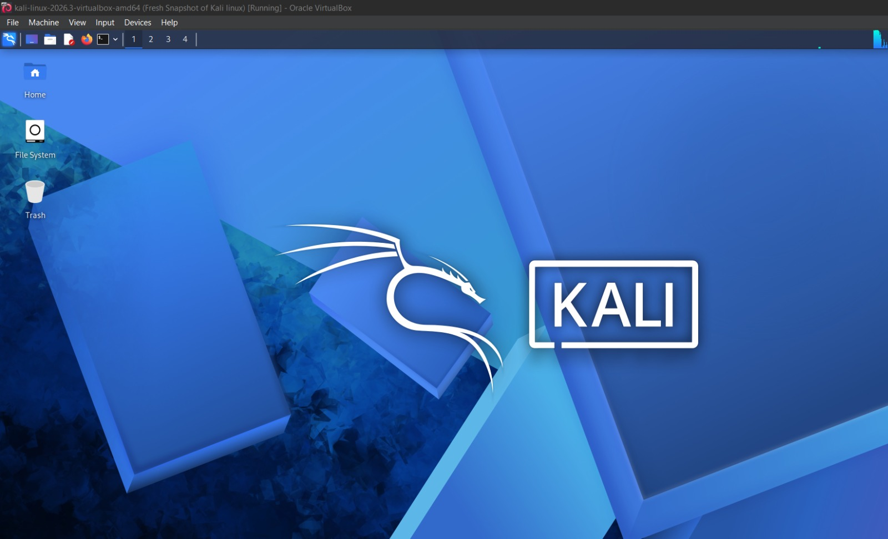
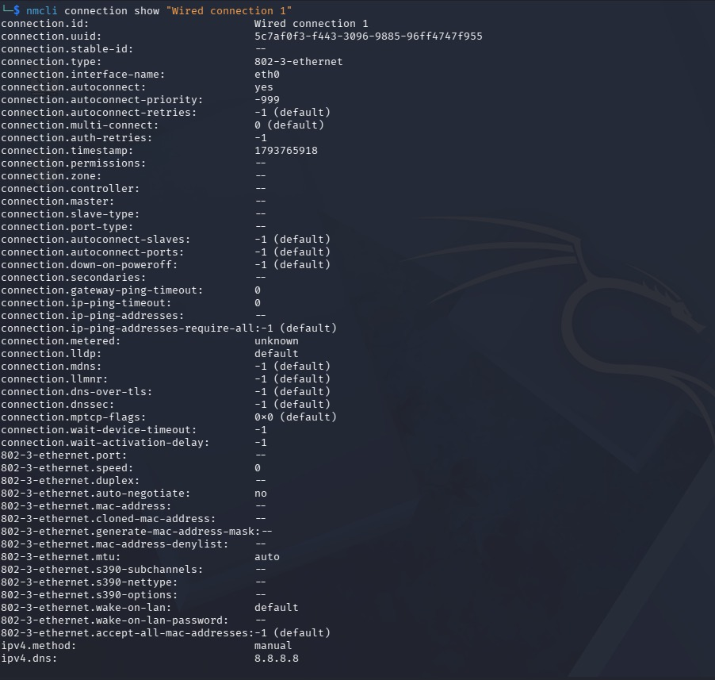

# 🔐 CYBERSECURITY HOME LAB SETUP
### Kali Linux | Oracle VirtualBox | Windows Host

---

## 📌 1. PROJECT OVERVIEW

This project documents the installation, configuration, and verification of a cybersecurity home lab using Kali Linux within Oracle VirtualBox.

The purpose of this lab is to establish a controlled virtual environment where practical cybersecurity skills can be developed through hands-on exercises, system configuration, networking activities, and security-related testing.

The lab provides a foundation for exploring both offensive security (Red Team) and defensive security (Blue Team) concepts.

### Project Information

| Category | Details |
|---|---|
| Project | Cybersecurity Home Lab Setup |
| Operating System | Kali Linux |
| Kali Version | 2026.3 |
| Virtualization Platform | Oracle VirtualBox |
| Host Operating System | Windows |
| System Architecture | 64-bit (x64) |
| Network Configuration | NAT Network |
| Lab Status | Completed |

---

## 🎯 2. PROJECT OBJECTIVES

The main objectives of this project were to:

- Install and configure Kali Linux in a virtual machine.
- Establish a functional virtual cybersecurity environment.
- Configure network connectivity within the virtual machine.
- Troubleshoot network connection and DNS resolution issues.
- Perform system updates and verify successful completion.
- Understand the relationship between a host operating system and a virtual machine.
- Develop foundational practical skills for future cybersecurity labs.

---

## 🔍 3. PURPOSE OF THE LAB

The purpose of this lab is to provide a safe and controlled environment for learning and practising cybersecurity concepts without directly affecting the host operating system.

Kali Linux provides access to various security tools used in penetration testing, vulnerability assessment, network analysis, and digital forensics.

By using virtualization, the lab allows the user to experiment with cybersecurity technologies while maintaining separation between the virtual environment and the physical computer.

The environment will also serve as a foundation for future practical exercises involving:

- Network security.
- Ethical hacking.
- Vulnerability assessment.
- Linux system administration.
- Network troubleshooting.
- Security monitoring.
- Defensive security practices.

---

## 🏗️ 4. LAB ARCHITECTURE

The lab consists of a Windows host computer running Oracle VirtualBox, which hosts the Kali Linux virtual machine.

The virtual machine uses a NAT Network configuration to establish network connectivity.

### Architecture Diagram

    INTERNET
        |
        |
    WINDOWS HOST SYSTEM
        |
        |
    ORACLE VIRTUALBOX
        |
        |
    VIRTUAL MACHINE
        |
        |
    KALI LINUX 2026.3
        |
        |
    NAT NETWORK
        |
        |
    NETWORK CONNECTIVITY

### Architecture Components

| Component | Description |
|---|---|
| Host Machine | Physical computer running Windows |
| VirtualBox | Virtualization software |
| Virtual Machine | Virtual computer created within VirtualBox |
| Kali Linux | Linux distribution used for cybersecurity activities |
| NAT Network | Virtual networking configuration used to provide network access |

---

## ⚙️ 5. LAB CONFIGURATION

The following components were used to establish the virtual cybersecurity environment.

### 5.1 Host System

The physical computer operates as the host system.

It provides the hardware resources required to run Oracle VirtualBox and the Kali Linux virtual machine.

### 5.2 Virtualization Software

Oracle VirtualBox was used to create and manage the virtual machine.

The software allows Kali Linux to operate independently within a virtual environment without requiring a separate physical computer.

### 5.3 Kali Linux Installation

The Kali Linux 2026.3 virtual machine image was downloaded and extracted before being imported and configured in Oracle VirtualBox.

The virtual machine was then started to verify that the operating system loaded successfully.

### 5.4 Network Configuration

The virtual machine was configured using the NAT Network option in VirtualBox.

Within Kali Linux, the network connection was managed through NetworkManager.

The network interface displayed the connection name:

`Wired connection 1`

Network configuration and DNS settings were reviewed during troubleshooting to establish successful connectivity.

### 5.5 System Updates

Following successful network configuration, system updates were performed to ensure that the Kali Linux environment had access to available package updates.

---

## 🛠️ 6. LAB SETUP PROCEDURE

The following steps outline the process used to establish the cybersecurity home lab.

### Step 1: Download Kali Linux

The Kali Linux 2026.3 virtual machine image was downloaded from the official Kali Linux website.

The downloaded file was provided in a compressed `.7z` archive format.

### Step 2: Extract the Virtual Machine Files

7-Zip was used to extract the downloaded archive.

The extracted files were prepared for use in Oracle VirtualBox.

### Step 3: Open Oracle VirtualBox

Oracle VirtualBox was launched to access the virtual machine management environment.

The extracted Kali Linux virtual machine was opened and prepared for configuration.

### Step 4: Configure the Virtual Machine

The virtual machine configuration was reviewed to ensure that the appropriate operating system and virtualization settings were available.

### Step 5: Start Kali Linux

The virtual machine was started.

Kali Linux successfully loaded, allowing access to the desktop environment and terminal.

### Step 6: Configure Network Connectivity

The network configuration was reviewed within Kali Linux.

The NAT Network option was used in VirtualBox, while NetworkManager was used to manage the guest operating system's network connection.

### Step 7: Troubleshoot Network Issues

During configuration, the virtual machine experienced connectivity and DNS resolution issues.

The network connection settings were reviewed and adjusted.

The connection was subsequently deactivated and reactivated to apply the configuration changes.

### Step 8: Verify Network Connectivity

Network connectivity was tested following the configuration changes.

The final connectivity test returned:

- 4 packets transmitted.
- 4 packets received.
- 0% packet loss.

This confirmed successful network communication during the test.

### Step 9: Perform System Updates

After connectivity was restored, the available Kali Linux package updates were installed.

The update process was completed successfully.

### Step 10: Final Lab Verification

The virtual machine was reviewed to confirm that Kali Linux remained accessible and that the lab environment was operational.

---

## 🌐 7. NETWORK CONFIGURATION AND VERIFICATION

Network configuration was one of the important components of this project.

Initially, Kali Linux experienced a DNS resolution issue.

The terminal displayed the following error:

`Ping: Google.com: Temporary failure in name resolution`

This indicated that the system was unable to resolve the domain name at that time.

### Troubleshooting Activities

The following troubleshooting activities were performed:

1. Reviewed the VirtualBox network configuration.
2. Confirmed the NAT Network selection.
3. Reviewed the Kali Linux network connection.
4. Examined the NetworkManager configuration.
5. Reviewed IPv4 and DNS settings.
6. Deactivated and reactivated the network connection.
7. Performed another connectivity test.

### Final Connectivity Result

    4 packets transmitted
    4 packets received
    0% packet loss

The successful test confirmed that the virtual machine was able to communicate over the network at the time of verification.

---

## 🔄 8. SYSTEM UPDATE VERIFICATION

System updates were performed after network connectivity was restored.

During the initial setup, Kali Linux displayed 928 packages available for upgrade.

The update process was subsequently completed successfully.

Updating the operating system is an important step because it helps ensure that the lab environment has current software packages and security improvements.

---

## 🖼️ 9. LAB SCREENSHOTS AND EVIDENCE

The following screenshots provide visual evidence of the installation, configuration, troubleshooting, and verification activities performed during the lab.

All seven screenshots will be added from the original screenshots captured during the project.

### 📸 Screenshot 1: Kali Linux Virtual Machine

Demonstrates the Kali Linux virtual machine within Oracle VirtualBox.

### 📸 Screenshot 2: VirtualBox Configuration

Shows the virtual machine configuration within Oracle VirtualBox.

### 📸 Screenshot 3: Network Configuration

Demonstrates the network configuration used to establish connectivity.

### 📸 Screenshot 4: Network Troubleshooting

Shows the network troubleshooting activities performed during the configuration process.

### 📸 Screenshot 5: Network Connectivity Verification

Provides evidence of the successful connectivity test.

### 📸 Screenshot 6: Kali Linux System Updates

Demonstrates the system update process.

### 📸 Screenshot 7: Final Lab Environment

Shows the completed Kali Linux environment following configuration and verification.

---

## ⚠️ 10. PROBLEMS ENCOUNTERED AND SOLUTIONS

Several challenges were encountered during the installation and configuration process.

| Problem Encountered | Troubleshooting / Resolution |
|---|---|
| Windows Security blocked the downloaded archive during extraction. | Reviewed the security warning and worked through the download and extraction issue. |
| Kali Linux experienced DNS resolution failure. | Reviewed IPv4 and DNS settings and the network connection configuration. |
| Virtual machine showed disconnected network status. | Reviewed the VirtualBox network selection and NetworkManager connection. |
| Network connection was not immediately restored. | Deactivated and reactivated the network connection. |
| Initial update attempt failed. | Restored network connectivity before attempting the updates again. |

These challenges provided practical experience in identifying configuration problems and applying troubleshooting techniques.

---

## 📚 11. WHAT I LEARNED

Completing this project provided valuable hands-on experience with Linux, virtualization, and network configuration.

Key learning outcomes included:

- Understanding how virtualization works.
- Installing and managing a Kali Linux virtual machine.
- Understanding the relationship between host and guest operating systems.
- Configuring virtual network connections.
- Understanding basic IPv4 and DNS settings.
- Using NetworkManager to manage network connections.
- Troubleshooting network connectivity issues.
- Verifying connectivity through packet transmission results.
- Performing Linux system updates.
- Documenting technical activities for a cybersecurity portfolio.

The project also reinforced the importance of patience, problem-solving, and systematic troubleshooting when working with technical environments.

---

## 🛡️ 12. CYBERSECURITY AND ETHICAL CONSIDERATIONS

This lab was established strictly for educational purposes and authorized cybersecurity practice.

All future security testing and experimentation will be conducted within environments where permission has been granted.

Responsible cybersecurity practices include:

- Obtaining authorization before performing security assessments.
- Respecting privacy and data protection.
- Avoiding unauthorized access to systems and networks.
- Using cybersecurity tools responsibly.
- Practising in controlled laboratory environments.

Ethical conduct is an essential part of developing a career in cybersecurity.

---

## 🔧 13. TOOLS AND TECHNOLOGIES USED

| Tool / Technology | Purpose |
|---|---|
| Windows | Host operating system |
| Kali Linux 2026.3 | Cybersecurity operating system |
| Oracle VirtualBox | Virtualization platform |
| 7-Zip | Archive extraction |
| NetworkManager | Network connection management |
| Linux Terminal | System administration and troubleshooting |
| NAT Network | Virtual network connectivity |
| GitHub | Project documentation and portfolio management |

---

## 🚀 14. FUTURE LEARNING AND DEVELOPMENT

This home lab will serve as the foundation for additional cybersecurity projects.

Planned learning activities include:

- Linux command-line administration.
- Networking fundamentals.
- Network traffic analysis.
- Vulnerability assessment.
- Ethical hacking fundamentals.
- Defensive security monitoring.
- Log analysis.
- Incident detection and response.

The long-term goal is to develop practical skills in both Red Team and Blue Team cybersecurity operations.

---

## ✅ 15. PROJECT CONCLUSION

The cybersecurity home lab setup was successfully established using Kali Linux 2026.3 and Oracle VirtualBox.

The project involved downloading and extracting the virtual machine image, configuring the virtual environment, troubleshooting network connectivity, verifying successful communication, and completing system updates.

Despite encountering initial download, network, and DNS configuration challenges, the issues were addressed through troubleshooting and configuration adjustments.

The completed environment provides a foundation for continued cybersecurity learning, experimentation, and practical skill development.

This project represents an important step toward building a practical cybersecurity portfolio and developing the technical knowledge required for future opportunities in the cybersecurity field.

---

## 👩🏽‍💻 AUTHOR

**Cybersecurity Student**

GitHub: [izzatiayb2106](https://github.com/izzatiayb2106)

Project Repository: [CYBERSECURITY LAB SETUP](https://github.com/izzatiayb2106/NETWORKWALKS-B083-WK1-PM1-CYBERSECURITY-LAB-SETUP)

---

*Learning. Practising. Securing.* 🔐
